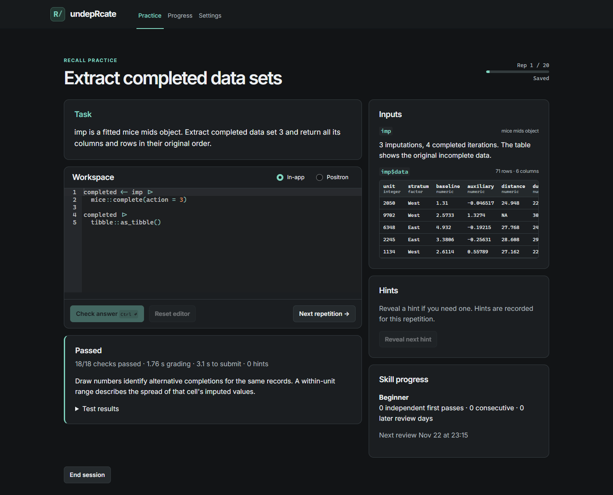

# undepRcate

undepRcate is a local R/Shiny trainer for practicing the same programming operation across fresh datasets. Choose a drill such as **Grouped summaries**, request 20 repetitions, and write the final R expression in the editor. Each submission runs against the displayed inputs and two hidden fixtures. Progress stays in SQLite on your computer.



## Launch on Windows

Install R 4.5.3 for the tested environment. Open the repository folder in Positron or open PowerShell there. Run setup once, then launch the app.

```powershell
git clone https://github.com/LystadJS/undepRcate.git
cd undepRcate
.\scripts\start.cmd scripts/setup.R
.\scripts\start.cmd
```

For an existing checkout, start with the setup command. The native Windows launcher works from Command Prompt or PowerShell and locates R on PATH, through the Windows registry, or under Program Files. Setup restores the versions in `renv.lock` into `.local-library/` and can reuse installed copies of matching versions. A fresh Windows x64 installation with R 4.5 uses dated Posit package repositories and CRAN. Packages that need compilation require Rtools45 on Windows.

The app opens [on localhost](http://127.0.0.1:3838). Stop it with Ctrl+C in the launch terminal. To choose another port, set `$env:UNDEPRCATE_PORT = "3839"` before launch. Set `$env:UNDEPRCATE_BROWSER = "0"` to suppress browser launch. On systems with Rscript on PATH, the equivalent commands are:

```sh
Rscript --vanilla scripts/setup.R
Rscript --vanilla run.R
Rscript --vanilla tests/testthat.R
```

Existing RReps users can update their checkout in place. Keep the project’s `.state/` and `practice/` directories with the renamed folder to retain saved sessions and history. The launcher continues to recognize the previous port and browser environment variables.

## A first session

1. Under **Practice**, select **Grouped operations → Grouped summaries**. Choose **Recall**, **20** repetitions, and **Sequential**.
2. Read the prompt and column types. The tidyverse is attached. Missing Data reference solutions use tidyverse operations and the native pipe, with qualified `mice::` calls for multiple imputation. The grader checks the returned object's meaning, including exact storage when the task specifies a typed schema. Return the requested object as the last expression. Function-writing exercises expect the function itself.
3. Press **Ctrl+Enter** to check. Expand **Test results** for the preview and hidden-fixture diagnostics. Retry the same data immediately after a miss. Hints progress from the concept to the technique, a partial example, and the explained answer.
4. After a pass, use **Alt+Enter** for the next variation. **Alt+Backspace** clears the in-app editor. On macOS, Command+Enter also checks an answer.
5. Advance after the final pass to finish the set. Open **Progress** for daily activity, filtered accuracy, time trends, mastery, and recent submissions. The next time a skill is due, **Review** starts five fresh recall repetitions.

The range is 5, 10, 20, 50, 100, or unlimited. A single drill stays on the same operation. A mixed category session opens more advanced drills after three and eight independent first passes within the category. Sequential practice advances through the available drills in difficulty order and increments the fixture seed. Randomized practice samples a seed and, in mixed sessions, an available drill. Every generated exercise can be reproduced with its template ID, seed, and difficulty.

| Mode | Practice behavior |
| --- | --- |
| Recall | Starts with an empty editor. In-app keyword suggestions are disabled by default and can be toggled in Settings. |
| Guided | Locks the order to Sequential. Study the worked example, then select **Finish lesson and start practice**. In repetitions 1 and 2, type over the faint answer for the current inputs. From repetition 3, write the answer from memory. |
| Speed | Counts down to your configurable per-repetition target. You can finish after the target expires and see the overrun alongside correctness. |
| Mastery | Tracks a three-pass checkpoint within the session for each drill. New, unaided first passes build the streak. A miss or hint resets it. The long-term skill rating also requires later reviews. |

Guided provides one opening lesson per set. In a mixed set it teaches the first scheduled drill, and the typing guide covers the first two repetitions of the set. Reopening the app restores your lesson or draft. Only the code you enter is saved and graded. In Positron mode the browser shows the reference beside the file instructions, and you type your answer in `answer.R`. The two guided repetitions count toward your practice total. Independent mastery credit begins with an unaided pass on a fresh variation. Hints remain available throughout practice.

The library has 62 drills across nine categories. **Missing Data** includes 32 drills in six stages, from finding missing or structurally inapplicable records to validating imputations, pooling model estimates, and reporting sensitivity to assumptions. Select the category and start with **Import records without losing missing codes**, or choose an individual drill directly. [Missing Data learning path and software notation](docs/MISSING-DATA.md)

## Practice in Positron

Open the project folder. If Positron asks whether you trust the folder, review the checkout and trust it to enable workspace tasks. Choose **Tasks: Run Task** in the command palette. The project supplies **undepRcate: Restore dependencies**, **undepRcate: Launch**, and **undepRcate: Run tests**. The terminal commands above work independently of IDE task support.

During a repetition, switch **Workspace** to **Positron**. The app shows the following commands with the actual exercise directory filled in:

- Open the repetition's `answer.R` with the displayed `positron -r` terminal command or the IDE file explorer.
- Source the sibling `context.R` in the R console to load the displayed fixture and packages for interactive work. Keep setup and console experiments outside `answer.R`.
- Save `answer.R` and click **Check answer** in the browser. undepRcate reads the saved file and uses the same subprocess and tests as the in-app editor. Unsaved IDE buffer changes are available after saving.

Each repetition has its own folder under `practice/`. Retries and restarts reuse that folder. The active exercise, editor draft, hints, submissions, settings, and mastery history persist under `.state/`. These directories are Git-ignored. Close the app before copying both directories for a backup. Only project-local task configuration is required. Positron uses your own editor preferences.

## Review scheduling and measurement

A clean first pass means the first graded encounter with that drill and seed was correct and unaided. Replaying a familiar seed or using a revealed solution earns practice credit. Independent first passes provide the evidence for advancing difficulty and mastery. An infrastructure error is excluded from learner performance.

- A failed answer resets the review interval and brings the drill back in ten minutes. A first assisted pass also schedules a short review when no due date exists.
- A first clean pass schedules the following local day. Later clean passes on due review days move through intervals of 1, 3, 7, 14, 30, and 60 days. Additional voluntary practice is always available.
- Same-day practice can build fluency. Long-term retention credit requires a new variation on a later date that is due. Within the queue, frequent recent mistakes and time overdue raise review priority.

| Skill level | Evidence required |
| --- | --- |
| Beginner | Starting level |
| Developing | At least 3 consecutive clean first passes |
| Proficient | At least 5 consecutive, 8 clean first passes total, and 1 successful later due-day review |
| Automatic | At least 10 consecutive, 15 clean first passes total, and 3 successful later due-day reviews |

Accuracy includes retries. A completed repetition is one passing variation. Solve time is wall-clock time from receiving the prompt to submitting the passing answer, including time away if you reopen an unfinished repetition. Grader time is displayed separately and includes worker startup and fixture checks. Practice streaks count days with a graded attempt. Daily goals count completed repetitions. The dashboard distinguishes lifetime mastery and streaks from the filtered training log.

## Execution and trust

**Run only your own trusted code.** The launcher binds Shiny to the loopback address. A disposable `callr` worker runs each submission with the filesystem and network permissions of your Windows account. The worker's temporary directory and time limit protect the app from ordinary mistakes. Hostile submissions can access that account's files or start other processes. Public or multi-user deployment needs an operating-system sandbox and separate resource limits.

The grader checks tables by their declared row order, column contract, values, types, and grouping. Function exercises call the submitted function on multiple inputs. Plot exercises inspect ggplot mappings, constructed layers, panel layouts, scales, and requested styling. Executable fixtures sample behavior and cannot establish equivalence on every possible input. Results distinguish syntax, runtime, semantic, timeout, and infrastructure failures. The default grading deadline is 15 seconds. To change it, open an R console in the project and run:

```r
options(undepRcate.timeout = 30)
source("run.R")
```

## Repository and tests

| Location | Responsibility |
| --- | --- |
| `run.R`, `app.R`, `scripts/` | Launch, locked dependency installation, and module loading |
| `R/practice_ui.R`, `R/app_server.R`, `R/training.R`, `www/` | Session setup, adaptive selection, editor interactions, and styling |
| `R/exercises*.R` | Template registry, seeded fixture generation, instructions, and hints |
| `R/grader.R`, `R/worker.R` | Process lifecycle and semantic assessment |
| `R/store.R`, `R/scheduler.R`, `R/mastery.R`, `R/analytics.R` | SQLite migrations, review scheduling, mastery checkpoints, and progress views |
| `R/positron.R`, `.vscode/tasks.json` | Per-repetition files and IDE launch tasks |
| `tests/testthat/`, `.github/workflows/` | Regression, integration, and Windows CI tests |

Run `.\scripts\start.cmd tests/testthat.R` from PowerShell. The suite exercises real R submissions, reproducible fixtures, alternative answers, false passes, subprocess failures, scheduling, SQLite restarts, and the complete 20-repetition grouped-summary workflow. Tests use disposable data. See the [exercise authoring guide](docs/EXERCISES.md) for a complete template example.

Before implementation, the [learnr exercise engine](https://github.com/rstudio/learnr/blob/main/R/exercise.R) and [gradethis grading examples](https://github.com/rstudio/gradethis/blob/main/inst/tutorials/grading-demo/grading-demo.Rmd) provided existing approaches to executable R exercises. undepRcate uses its own generated fixtures and scheduling rules and relies on [callr](https://github.com/r-lib/callr) for subprocess execution. Released under the [MIT license](LICENSE).
